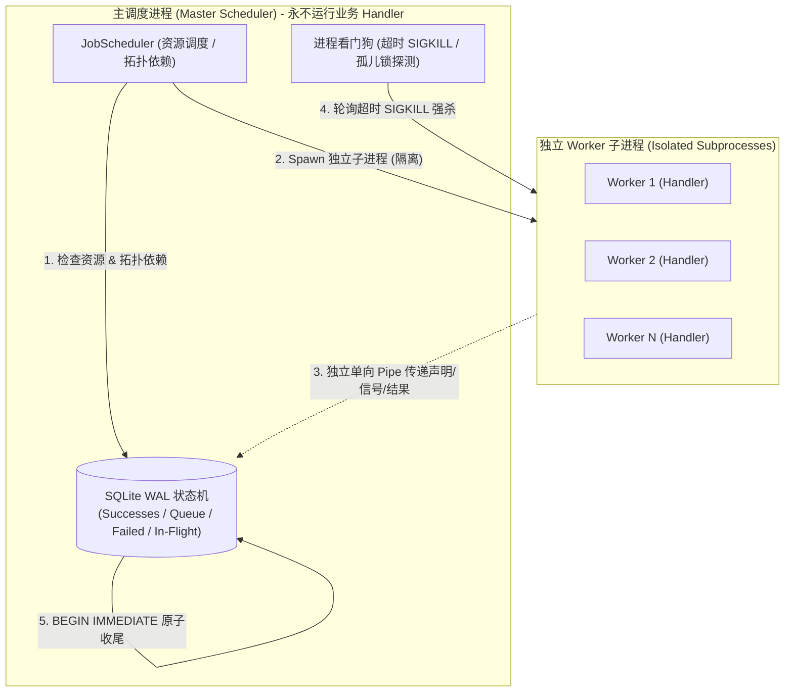

# ⚡ TaskLite — 零依赖、进程隔离的轻量任务编排引擎

> **A Lightweight Task Orchestration Engine for Agent & Batch Pipelines.**  
> 专为 **AI Agent 批量处理**、数据同步与采集、音视频转码、离线 ETL 与后台批处理任务打造。  
> 核心解决「单线程处理耗时长」、「中途失败需全量重跑」、「子任务卡死拖垮主流程」等工程痛点。采用类似 **systemd** 的守护与物理进程隔离架构，内置 SQLite WAL 事务持久化，子进程崩溃或断电不坏库，重启自动断点续跑。

[](https://www.python.org/)
[](LICENSE)
[]()
[-orange.svg)]()
[]()

---

## 💡 为什么选择 TaskLite？

在运行大量并发任务（如 AI Agent 批量调用、大模型推理批处理、多媒体文件处理、离线数据流转）时，常见方案常面临以下痛点：

- **单脚本串行或简单循环**：
  - ❌ 单线程处理速度慢、耗时长；
  - ❌ 跑上千个任务时，第 800 个报错导致整个程序终止，缺乏断点记录，下次必须**全量重跑**。
- **标准库进程池 (`multiprocessing.Pool` / `ProcessPoolExecutor`)**：
  - ❌ 缺乏内置状态持久化，程序中断后已完成进度丢失；
  - ❌ 子任务发生 C 扩展段错误 (SIGSEGV) 或内存泄露 (OOM) 时，容易导致主进程一同崩溃；
  - ❌ 缺少全局速率限制与服务熔断机制，缺乏 DAG 拓扑依赖与失败隔离。
- **重型分布式任务队列 (`Celery` / `Airflow` / `Temporal`)**：
  - ❌ 强依赖 Redis、RabbitMQ、PostgreSQL 等外部服务，本地单机运行或轻量嵌入脚本时运维成本过高；
  - ❌ 架构较重，不适合作为随用随走的轻量批处理脚手架。

**TaskLite 的设计定位**：  
**零依赖的单机批处理脚手架**——只需 `pip install tasklite-engine`。
1. **多 Worker 并发加速**：多进程并行执行，充分利用多核算力，彻底解决单线程耗时长的问题；
2. **断点续跑防重跑**：以 SQLite WAL 事务表记录状态，已完成的任务自动跳过，失败任务立即重入队重试、预算耗尽进失败档案，杜绝因个别失败导致全量重跑；
3. **物理隔离与容灾**：主进程只负责调度，业务逻辑在独立子进程中运行并设超时强杀，即使子任务崩溃、死锁或系统断电，状态依然完整可恢复。

---

## 📊 方案对比矩阵

| 特性维度 | TaskLite | ProcessPoolExecutor | Celery | Airflow / Prefect |
| :--- | :---: | :---: | :---: | :---: |
| **外部依赖** | **零依赖 (标准库+SQLite)** | 零依赖 | 需 Redis / RabbitMQ | 需 DB + Web Server |
| **物理进程隔离** | **独立 spawn 子进程 + SIGKILL** | 进程池复用（易污染） | Worker 进程池 | 依赖 Runner 调度 |
| **子进程异常隔离** | **主进程不崩溃，支持自动重试** | 进程退出 | Worker 重启（易丢任务） | 需外部重启 |
| **状态持久化** | **SQLite WAL ACID 事务** | 无持久化 | 依赖 Broker 配置 | 数据库记录 |
| **抗漂移增量探索 (Discovery)** | **内置函数式无游标去重** | 无 | 无 | 需自定义传感器 |
| **全局限速与持久化休眠** | **内置令牌桶 + 跨重启持久化** | 无 | 需 Redis 限流组件 | 需复杂调度配置 |
| **DAG 依赖与级联熔断** | **内置拓扑依赖 + 自动跳过** | 无 | 需 Canvas 复杂编排 | 原生支持 |
| **产物沙盒与显式清理授权** | **内置 declare_output** | 无 | 无 | 需自定义 Hook |

---

## 🏗️ 核心架构与设计哲学



### 三层崩溃恢复防线
1. **执行代标识与通道绑定 (Generation Fencing)**：每 worker 绑定独立单向 `Pipe` 与 `{run_id}.{dispatch_no}` 执行代标识，校验 `job_uid` 与 `execution_id`，旧执行与伪造消息无法污染状态机；
2. **可信成功事务持久化**：IPC 仅负责本次运行的瞬时通信，已提交的成功档案、`attempts` 终态与资源挂起由 SQLite 强事务持久化，未提交在途任务重启后自动接续重做；
3. **孤儿文件锁探测 (Lockfile Fencing)**：严格保证同一 UID 在全局只有一个物理执行体，主进程崩溃后孤儿持锁期间新 Run 自动避让。

---

## 🌟 核心特性

### 1. 🛡️ 进程隔离与守护 (Process Isolation)
- 主进程作为总控调度器，不执行具体的业务代码；
- 每一个任务均在独立的 `spawn` 子进程中隔离执行；
- 当子进程发生死循环或超时，看门狗将在指定超时后发送 `SIGKILL` 强杀子进程并自动回收资源；
- 子进程发生异常退出或被操作系统终止时，不影响主调度进程的稳定运行。

### 2. ⚡ SQLite WAL 状态持久化 (ACID)
- 基于 SQLite WAL + `synchronous=FULL` 模式；
- 状态机（Successes 成功档案 / Queue 待办 / In-Flight 在途 / Failed 失败档案）在单次事务中原子转移；
- 遭遇中断或异常关机时，重启后支持 At-Least-Once 接续执行。

### 3. 🔍 函数式增量探索 (Functional Discovery)
- 针对数据同步、采集与拉取场景的无游标 (Cursor-less) 增量扫描；
- 直接复用成功档案 (Successes) 即时判定已见内容，整页命中自动刹车，天然免疫上游记录删除、插入导致的游标漂移。

### 4. ⏸️ 全局限流与配额熔断持久化休眠
- 内置 `RateLimitResource`（速率限制）与 `CapacityResource`（并发限制）；
- 遇到 HTTP 429 速率限制或配额超限时，调用 `ctx.suspend_resource("api", 3600)` 挂起全管线，休眠状态跨进程、跨重启持久化。

### 5. 🔗 DAG 拓扑依赖与级联熔断
- 任务通过 `depends_on` 声明依赖；
- 父任务失败进入失败档案时，所有下游依赖自动标记跳过 (`ERR_JOB_DEPENDENCY`)，避免无效计算。

### 6. 📦 具名磁盘产物与显式清理授权
- `ctx.declare_output(path, name=...)` 声明文件或目录产物并随成功事务原子发布，下游通过 `ctx.get_artifact_path(...)` 安全引用直接依赖的产物路径；
- 前置删除、失败清理与成功清理分别由 `delete_existing`、`delete_on_failure`、`delete_on_success` 显式授权（`declare_cache` 固定成败自动清理），收尾时先清理后提交。

### 7. 🌐 组合式 HTTP 网络工具与快照守卫 (HTTP Wrappers)
- 开放 Callable 设计，支持原生 `urllib`、`requests`、`httpx` 或平台自定义签名 SDK；
- `http_guard` 自动捕获 429、解析 `Retry-After` 并触发 `ctx.suspend_resource` 全管线挂起，配合 `SQLiteSnapshotStore` 支持原始响应快照持久化与全离线幂等重放。

### 8. 🎛️ 调度扩展 Seam（排序 / 重试节奏 / 执行选择）
- 核心零调度计算，提供 `OrderingPolicy`（候选访问序）、`RequeuePolicy`（重入队节奏）与 `Selection`（候选准入）三类正交扩展接缝；
- `pipeline.selection(Exclude(task_type="..."), Skip(task_type="..."))` 支持按任务类型配置**延迟留队（Exclude）**与**终态跳过（Skip）**。

---


## 🚀 快速上手 (Quickstart)

### 安装

要求 **Python ≥ 3.10**，零外部依赖：

```bash
pip install tasklite-engine
```

> **三方命名对照**：仓库名 `tasklite`，PyPI 包名 `tasklite-engine`（PyPI 的 `tasklite` 名已被无关项目占用），Python 导入名 `tasklite`——安装 `tasklite-engine`、`import tasklite`。

### 最小示例

```python
import logging
from tasklite import TaskLite, Job, RetryError, RateLimitResource

logging.getLogger("tasklite").setLevel(logging.INFO)

# 1. 定义任务处理器（在独立子进程中执行，必须模块级定义）
def download_handler(job: Job, ctx):
    # 声明产出文件（失败时自动清理半残文件）
    out = ctx.declare_output(f"./downloads/{job.job_id}.jpg", delete_on_failure=True)

    # 模拟业务下载
    success = do_download(job.payload["url"], out)
    if not success:
        raise RetryError("网络抖动，立即重入队重试")

    return True, {"size": 1024, "path": str(out)}

# 2. 初始化引擎（六步调用契约：初始化 → register_resource → register_task → enqueue → run → stop）
pipeline = TaskLite(
    name="media_downloader",
    state_dir="./state",        # 状态持久化目录（SQLite WAL）
    output_roots="./downloads",  # 产物沙盒根目录
    max_workers=4,              # 并发子进程数（内部 __workers__ 容量资源，可覆盖）
)

# 3. 注册全局限速（每秒最多 2 次请求）与 Task 规格
pipeline.register_resource(RateLimitResource("api", interval_seconds=0.5))
pipeline.register_task("download", download_handler, resources={"api": 1.0})

# 4. 入队并启动（阻塞直到队列全部完成，返回 RunSummary）
pipeline.enqueue([
    Job("download", "img_001", payload={"url": "https://example.com/1.jpg"}),
    Job("download", "img_002", payload={"url": "https://example.com/2.jpg"}),
])
pipeline.run()
```

> 引擎采用 **Task（静态规格） / Job（逻辑实例） / Attempt（执行轨迹）** 三层模型，完整 API 签名、触发器（Trigger）、产物授权、失败档案与调度扩展 seam 请查阅 **[`docs/GUIDE.md`](docs/GUIDE.md)**（使用手册）。

---

## 🍳 常见场景速览 (Recipes)

### Recipe 1: 增量分页扫描器 (Discovery)

无需游标，增量同步时只要发现整页内容已全部处理过，自动刹车停止扫描：

```python
from tasklite.wrappers.discovery import register_discovery

def fetch_page(job, ctx, page: int):
    return api.get_author_posts(author_id=job.payload["author_id"], page=page)

def item_id(post) -> str:
    return str(post["id"])

def process_item(job, ctx, post, content_id: str):
    ctx.spawn(Job("download", content_id, payload={"url": post["url"]}))

register_discovery(
    pipeline,
    task_type="discover_author",
    fetch_func=fetch_page,
    id_func=item_id,
    process_item_func=process_item,
    process_task_type="download",
    resources={"api": 1.0},
)
```

### Recipe 2: DAG 依赖级联与按输入 `mtime` 自动重跑

通过 `depends_on` 声明拓扑依赖，配合 `trigger="on_input_change"` 与 `ctx.declare_input(path)` 实现 make 式级联更新（完整可运行示例见 [`examples/trigger_chain.py`](examples/trigger_chain.py)）：

```python
download_job = Job("download", "video_101", payload={"url": "https://example.com/v.mp4"})
transcode_job = Job(
    "transcode",
    "video_101",
    payload={"preset": "1080p"},
    depends_on=[download_job.uid],  # 上游本批就绪后再判定下游，上游失败则自动级联阻断
    trigger="on_input_change",      # 输入文件 mtime 晚于上次可信成功完成时间才重跑
)

pipeline.enqueue([download_job, transcode_job])
pipeline.run()
```

### Recipe 3: 遭遇 429 限流与配额熔断全局休眠

```python
from tasklite import RateLimitHit

def fetch_handler(job, ctx):
    resp = requests.get(job.payload["url"])
    if resp.status_code == 429:
        # 全管线挂起 api 资源 1 小时，状态持久化到磁盘，随后抛出瞬态重试
        ctx.suspend_resource("api", seconds=3600)
        raise RateLimitHit("Triggered 429, suspending API for 1h")
    return True, resp.json()
```

### Recipe 4: AI Agent / 大模型批量任务断点续跑

```python
import json
from pathlib import Path
from tasklite import TaskLite, Job, RateLimitResource

def agent_worker(job: Job, ctx):
    result = call_llm(job.payload["prompt"])
    out_path = Path(ctx.declare_output(f"./results/{job.job_id}.json", delete_on_failure=True))
    out_path.write_text(json.dumps(result, ensure_ascii=False))
    return True, {"tokens": result.get("usage", 0)}

pipeline = TaskLite(name="agent_batch", state_dir="./agent_state", max_workers=8)
pipeline.register_resource(RateLimitResource("llm_rpm", interval_seconds=0.1))
pipeline.register_task("analyze", agent_worker, resources={"llm_rpm": 1.0})

pipeline.enqueue([
    Job("analyze", f"doc_{i}", payload={"prompt": f"分析文本 {i}"})
    for i in range(1000)
])
pipeline.run()
```

### Recipe 5: 官方 HTTP 守卫与原始响应快照重放 (HTTP Wrappers)

```python
from tasklite import TaskLite, RateLimitResource
from tasklite.wrappers.http import SQLiteSnapshotStore, http_guard, urllib_fetch

pipeline = TaskLite("crawler", state_dir="./states")
pipeline.register_resource(RateLimitResource("api", interval_seconds=1.0))

snapshot_store = SQLiteSnapshotStore("./snapshots.db")
cached_fetch = snapshot_store.cached(urllib_fetch)

def crawler_handler(job, ctx):
    with http_guard(ctx=ctx, resource="api", default_suspend_ttl=60.0):
        resp = cached_fetch(job.payload["url"])
        return resp.json()

pipeline.register_task("fetch", crawler_handler, resources={"api": 1.0})
```

---

## 📚 文档导航与职责划分

仓库内各文档按受众与职责严格正交划分，避免重复维护：

| 文档 | 定位与职责 |
| :--- | :--- |
| **[`README.md`](README.md)** | **项目门户与快速上手**：解决痛点、架构概览、安装与最小示例、常见场景 Recipes 速览、目录结构 |
| **[`docs/GUIDE.md`](docs/GUIDE.md)** | **使用手册**：公开导入面、三层模型与 Schema 5、触发器与恢复边界、`JobContext` 与产物清理授权、失败档案运维 API、三类调度扩展 seam |
| **[`CONTEXT.md`](CONTEXT.md)** | **领域通用语言词典**：核心领域模型与引擎内部组件的标准术语定义及禁用词表 |
| **[`docs/adr/`](docs/adr/)** | **架构决策记录（ADR）**：关键架构演进、设计取舍与边界裁决依据 |
| **[`docs/ROADMAP.md`](docs/ROADMAP.md)** | **未来演进路线图**：已分析但尚未立项实施的储备方向（实施前须立项 ADR） |
| **[`AGENTS.md`](AGENTS.md)** | **研发红线与工作流规范**：测试门槛、原子提交纪律、分层依赖红线与注释规范 |
| **[`CHANGELOG.md`](CHANGELOG.md)** | **版本变更日志**：各发布版本的显著特性与破坏性变更记录 |

---

## 📁 目录结构

```
tasklite/
├── pipeline.py          # TaskLite 核心门面与配置
├── selection.py         # 执行选择规则值对象 Exclude/Skip（候选准入 seam，ADR-0006）
├── hooks.py             # 用户工具函数（job_ref / progress_hook / slice_list）
├── engine/              # 核心执行机器群
│   ├── runtime.py       # 核心运行期深模块、主循环事件泵 (EngineRuntime)
│   ├── config.py        # RunConfig 静态装配快照、默认值唯一解析点
│   ├── session.py       # RunSession 单次 run 生命周期状态与钩子单一出口
│   ├── wait.py          # 事件泵等待/空闲决策纯函数
│   ├── types.py         # 引擎公共值对象单一真相源
│   ├── store.py         # 状态事务、3-strike 崩溃与失败写入隔离 (StateStore)
│   ├── ops.py           # OpsConsole：run() 外纯运维接缝（管理 API 委托目标）
│   ├── dispatch.py      # 任务派发状态机 (DispatchMachine)
│   ├── completion.py    # 任务完成与提交 (CompletionMachine)
│   ├── recovery.py      # 崩溃检测与恢复 (RecoveryOrchestrator)
│   ├── channel.py       # IPC 与子进程执行通道 (ExecutionChannel / WorkerLaunchSpec)
│   ├── scheduler.py     # 资源调度与 DAG 依赖 (JobScheduler / OrderingPolicy 排序 seam / Selection 候选准入 seam)
│   ├── admission.py     # trigger 注册与求值 (TriggerRegistry) 与重入队节奏 (RequeuePolicy seam)
│   ├── governor.py      # 死锁归因仲裁与依赖宽限，消费选择停摆事实 (DeadlockGovernor)
│   ├── selection.py     # Skip 闭包与选择停摆图事实 (SelectionMachine)
│   ├── in_flight.py     # 在途作业租约追踪 (InFlightTracker)
│   ├── errorclass.py    # 错误分类与校验分类深模块 (ErrorClassifier)
│   └── resource.py      # 令牌桶限速与并发容量资源
├── backend/             # SQLite WAL 强一致事务持久化后端
├── models/              # Task / Job / Attempt / PipelineState / JobContext 数据模型
├── testing.py           # fake_ctx：handler 单测的官方 JobContext 构造器
├── wrappers/            # discovery.py（增量扫描）/ http.py（网络守卫与快照）
├── contrib/             # 生态扩展套件与参考实现（核心不依赖）
└── utils/               # encoding（单射 %XX 转义）/ ipc（瞬时 Pipe 通道与产物清理原语）/ clock / jsonutil（禁NaN）/ lockfile
```

---

## 📄 开源许可证

本项目基于 [MIT License](LICENSE) 开源。
