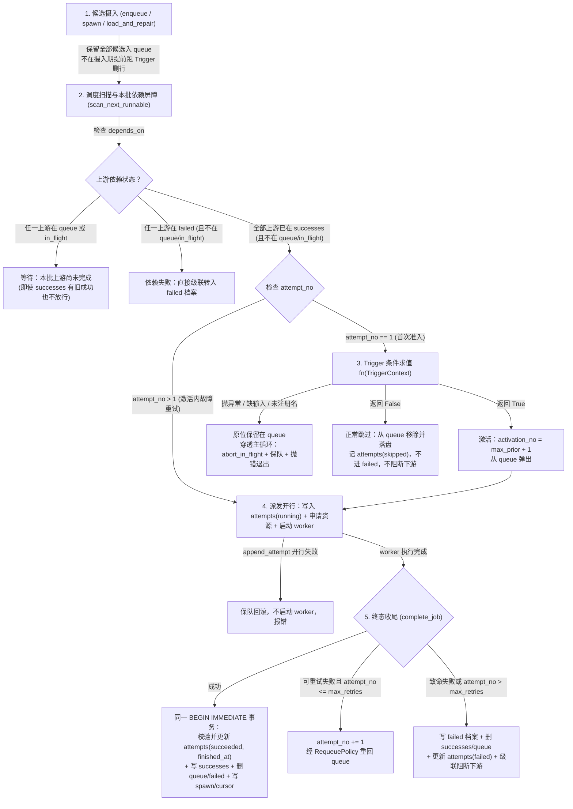

# 0008 触发器（Trigger）重跑契约、Task 模板继承与可信成功基线

状态：已接受并实施（schema 5）。

## 1. 背景与问题陈述

在 Task / Job / Attempt 三层模型下，围绕「何时触发一次新的 Job 执行（Activation）」与「如何安全判定输入文件变化」存在五项结构性缺口：

1. **提前求值与逆序入队丢失候选**：现有实现分别在启动加载恢复（`repair_queue_on_load`）、子任务派生摄入（`_collect_spawned_dicts`）以及派发预检首关（`dispatch_dedup`，先于依赖失败检查且先 `pop` 出队）执行重跑判断；当 `A → B` 逆序入队或同批入队时，`B` 在上游 `A` 尚未执行完成前就按旧状态被提前跳过或丢弃，且若 `A` 在本批执行失败，`B` 可能借 `A` 的历史旧 `successes` 记录被错误放行。
2. **`successes` 与 `attempts` 分步写入导致基线不可信**：现有 `apply_success` 先提交 `successes` 表，再于独立事务更新 `attempts` 表且吞掉写错；`seed_successes` 人工种子与 `clear_history` 清空 `successes`（保留 append-only `attempts`）后，若直接查询 `attempts` 表的历史成功行，会把旧 `attempts.finished_at` 误认为当前成功基线。
3. **重跑策略硬编码于引擎内部且概念命名含混**：参数名 `rerun` 搭配默认值 `"never"` 易被误解为「从不运行」；文件状态比对（保存历史 `(size, mtime_ns)`）写死在核心层，外部无法注册自定义触发条件；`PipelineState` 通过硬编码字符串集合（`_is_rerun_exempt` / `rerun_active_uids`）维护豁免状态。
4. **`Task` 模板参数未真正被 `Job` 继承**：`Task` 虽声明了 `max_retries`、`timeout_seconds`、`timeout_is_transient` 等默认规格字段，但 `Job.__init__` 直接将默认值写死为具体常数而非 `None` 未指定哨兵，且引擎从未读取 `Task` 上的这三项默认规格，导致 `Task` 作为 `Job` 模板的契约名存实亡；同时 `Task` 缺少默认触发器字段，导致 Discovery 只能通过私有 `_discovery_rerun` 字典旁路注入。
5. **输入声明包含冗余快照与无语义 URI**：`declare_input` 保存了历史文件大小与时间戳快照，把缺文件当成「输入变化」静默放行；`declare_input_uri` 在本地文件 `mtime` 判据下无实际比较语义。

---

## 2. 区分：已确认前提、候选方案比较与最终裁决

### 2.1 已确认前提（Confirmed Context）

- 保持 Task / Job / Attempt 三层模型与稳定身份 `uid = f"{task_type}::{job_id}"`，不通过每次拼接新 `job_id` 实现重跑。
- `run()` 期间参与的声明输入与输出文件仅由当前执行中的对应 Job 修改，外部程序或其他运行实例不并发篡改。
- 不引入运行期热入队、尾随补跑（trailing rerun）、常驻 daemon、自动扫描磁盘发现未入批下游 Job，也不新增 `successes` → `attempts` 的外键关联列。

### 2.2 核心分支候选比较与裁决结果（Candidates & Decisions）

#### 裁决一：可信成功基线的识别与旧库边界
- **候选 A（同事务时间戳对账，不升 schema）**：保持 schema 4，靠比对 `successes.metadata` 与 `attempts` 的时间戳识别可信度。
- **候选 B（在 `successes.metadata` 写专用布尔标记）**：额外增加内部标记位区分原子事务。
- **候选 C（已选定：升级 `user_version = 5` 拒绝非原子旧库 + 成功事务原子化 + 排除 `seed_successes` 空记录）**：
  - 将 SQLite 持久化 schema 版本升级为 **`user_version = 5`**，明确拒绝所有在「`successes` 与 `attempts` 同事务原子提交」改造前生成的旧库（schema $\le 4$），保留原库并给出清晰版本边界提示，不自动迁移或删库。
  - 在 schema 5 下，正常成功提交（`commit_job_success`）必须在**同一个 `BEGIN IMMEDIATE` 事务**内校验并更新对应 `attempts` 行的 `outcome = 'succeeded'` 与 `finished_at`，同时写入 `successes` 表（强制写入框架键 `last_succeeded_at = finished_at`、`last_success_run_id = run_id`、`success_count`，禁止用户 `result_metadata` 同名键覆盖）。派发阶段 `append_attempt` 开行失败时必须保队并终止派发，绝不允许缺少 `attempts` 行的作业执行并声称成功。
  - `seed_successes` 写入空元数据 `{}`。当查询某 `job_uid` 的可信成功基线时间时：只要 `job_uid` 在 `successes` 中存在且包含框架写入的成功运行元数据（非 `seed_successes` 的 `{}`），即可信地读取 `attempts` 表中该 `job_uid` 最新 `outcome = 'succeeded'` 行的 `finished_at`；若 `job_uid` 不在 `successes` 或仅为 `seed_successes` 写入的空记录（即使 `attempts` 表残留有 `clear_history` 之前的历史成功行），一律判定为**无成功时间基线**（保守触发执行）。

#### 裁决二：触发器（Trigger）命名、注册接口与 `Task` 模板继承统一
- **候选 A**：保留 `rerun` 参数名与 `"never"` / `"every_run"`。
- **候选 B**：只在 `register_task` 绑函数，不允许 `Job` 按名称覆盖。
- **候选 C（已选定：统一改用 `trigger`，默认 `"once"`，内置四策略 + `register_trigger` 按名扩展，且修复 `Task` → `Job` 全部 5 项规格继承）**：
  - **废除 `rerun` 参数，统一命名为 `trigger`**：
    - 四个内置触发器名称：
      1. `"once"`（默认，替代原 `"never"`）：整个生命周期只触发一次——仅当既不在 `successes` 也不在 `failed` 时返回 `True`；命中任一历史终态均返回 `False`（跳过）。
      2. `"on_failure"`：未成功则触发——全新或命中 `failed` 时返回 `True`；命中 `successes` 时返回 `False`（跳过）。
      3. `"on_input_change"`：输入更新时触发——全新、命中 `failed`、或命中 `successes` 但缺乏可信基线时间时返回 `True`；命中具备可信基线时间的 `successes` 时，任一声明输入路径的当前修改时间严格晚于上次成功完成时间则返回 `True`，否则返回 `False`。
      4. `"always"`（替代原 `"every_run"`，Discovery 默认值）：每次入队运行均返回 `True`。
    - 自定义触发器注册：`pipeline.register_trigger(name: str, fn: Callable[[TriggerContext], bool])`。注册时校验 `name` 为非空字符串（禁止覆盖内置四名称或重复注册同名触发器）且 `fn` 可调用。`Task` 与 `Job` 仅存储和序列化触发器的字符串名称 `str`，绝不将函数对象序列化进 `Job` 快照。
    - 全权统一求值：无论是全新未执行过的 `Job` 还是命中历史终态的 `Job`，在开始一次执行前均统一调用对应的 `fn(ctx: TriggerContext) -> bool`（内置四策略与自定义触发器完全同构）。
  - **`Task` 模板与 `Job` 实例的 5 项规格参数全面统一**：
    - `Task`（及 `pipeline.register_task`）作为 `Job` 的静态规格模板，持有全部 5 项默认规格：
      - `resources: dict[str, float] | None = None`（规范化为 `{}`）
      - `max_retries: int = 3`
      - `timeout_seconds: int | float = 3600`
      - `timeout_is_transient: bool = False`
      - `trigger: str = "once"`（`register_discovery` 注册的发现任务默认设置 `trigger="always"`，彻底移除原有的 `set_discovery_rerun` 与 `_discovery_rerun` 旁路字典）
    - `Job` 构造函数的对应 5 项规格参数默认全部采用 `None`（未指定哨兵）：
      - `resources: dict[str, float] | None = None`
      - `max_retries: int | None = None`
      - `timeout_seconds: int | float | None = None`
      - `timeout_is_transient: bool | None = None`
      - `trigger: str | None = None`
    - 继承与覆盖规则：当 `Job` 的某项规格字段为 `None` 时，自动继承其所属 `Task` 规格的对应值（`resources` 按键值合并，`Job` 显式声明的同名资源键覆盖 `Task` 默认值）；当 `Job` 显式传入非 `None` 值时，以 `Job` 显式值为准。

#### 裁决三：`trigger` 与 `max_retries` 的职责正交边界（零新增持久化状态）
- **核心正交划分**：
  - **`trigger` 决定一个 `Job` 是否开始一次新的执行（Activation，`attempt_no == 1`）**：
    - 返回 `False` 代表「无需执行，正常跳过（`skipped`）」，从队列移除，不写 `failed` 档案，下游依赖它的任务继续正常流转。
    - 返回 `True` 代表「准入开始本次执行」，推进激活代 `activation_no = max_prior_activation + 1`，进入子进程派发。
  - **`max_retries` 决定同一次执行（Activation）内部的故障重试细节（`attempt_no > 1`）**：
    - 当子进程第 1 次尝试（`attempt_no == 1`）报错退出且满足重试条件（`attempt_no <= max_retries`）时，收尾模块将 `attempt_no` 递增为 `2` 并放回队列。
    - 队列中所有 `attempt_no > 1` 的作业，均代表**已通过 `trigger` 准入、正在同一次激活内进行故障抢救重试**的作业——派发时直接沿用当前 `activation_no` 与 `attempt_no` 继续执行，**不再重复调用 `trigger`，也绝不重置 `attempt_no`**；若重试耗尽（`attempt_no > max_retries`），在子进程收尾时直接写入 `failed` 失败档案并级联阻断下游。
    - 若 `attempt_no == 1` 的作业遭遇瞬态信号（`KeyboardInterrupt` / 孤儿锁 `lock_conflict` / 限速 `RateLimitHit`），按瞬态军规重回队列后其 `attempt_no` 仍为 `1`，下次派发（或跨 `run()` 崩溃恢复）时自然重新走 `trigger` 求值。
- **零新增持久化字段与状态机简化**：
  - 单凭 `Job` 现有的 `attempt_no == 1` 与 `attempt_no > 1` 即可完备区分「首次激活准入」与「激活内故障重试」，`JobRuntimeState` 与数据库均**不新增任何 `_activated` 字段**。
  - 彻底删除 `PipelineState` 中的 `_is_rerun_exempt`、`rerun_active_uids`、`mark_rerun_active` 及 `RERUN_EXEMPT_VALUES`：在「入队保留候选、依赖就绪后求值」模型下，`queue` 或 `in_flight` 中的作业在终结前与历史 `successes` / `failed` 重叠属正常态；`PipelineState` 只维护两条核心互斥不变式：
    1. `successes ∩ failed == ∅`（历史成功与历史失败严格互斥）；
    2. `queue ∩ in_flight == ∅`（排队与在途严格互斥，且各自内部无重复 `job_uid`）。

#### 裁决四：输入声明（`declare_input`）、微秒整数时间比较与错误契约
- **砍除 `declare_input_uri`，`declare_input(path)` 仅存规范路径字符串**：
  - 移除无本地 `mtime` 比较语义的 `JobContext.declare_input_uri`。
  - `ctx.declare_input(path)` 在调用点解析规范绝对路径并立即校验路径在磁盘上存在（不存在立即抛 `FileNotFoundError`）；成功提交时 `successes.metadata["inputs"]` 仅保存去重保序的规范路径字符串列表 `list[str]`（不再保存历史 `size` 与 `mtime_ns`）。支持声明文件或目录（目录仅 `os.stat` 目录自身，不递归遍历子项）。
- **空输入与缺失输入一律报错（Fail-loud）**：
  - 当 `trigger="on_input_change"` 命中可信成功档案（已有 `last_succeeded_at` 基线）时：
    - 若 `successes.metadata.get("inputs")` 缺失、非列表或为空列表 `[]`，直接抛出 `ValueError`（声明使用 `on_input_change` 却未记录任何输入路径属契约错误，严禁静默跳过或静默退化为 `always`）；
    - 对 `inputs` 中的每个路径执行 `os.stat(path)`，若路径不存在或不可访问（`OSError`），直接抛出异常（严禁把输入文件丢失当作「输入变化」或「未变化」）。
- **时间精度统一归一化为整数微秒（`us`）**：
  - `attempts.finished_at` 为 UTC ISO 8601 字符串（微秒精度 $10^{-6}\text{ s}$），`os.stat(path).st_mtime_ns` 为纳秒整数（$10^{-9}\text{ s}$）。
  - 为消除 ISO 时间戳截断亚微秒（最后 3 位纳秒恒为 `000`）导致的「同一微秒内写入文件被误判为晚于完成时间」，比较时统一转换为**整数微秒（`int`）**：
    - `finished_at_us = parse_utc_iso_to_us(finished_at)`
    - `mtime_us = st.st_mtime_ns // 1_000`
    - 触发条件为存在任一输入路径满足 **`mtime_us > finished_at_us`**（严格大于；相等不触发）。
  - 输入 `stat` 缓存不得跨上游任务完成点复用（每次有在途任务完成结算时清空或按单次求值周期隔离）。

#### 裁决五：Trigger 求值异常的停止与在途回收路径
- 与 `Selection` 规则异常完全同构：
  - Trigger 求值发生在候选满足本批依赖就绪之后、**从队列移除（`pop`）之前、写入 `attempts` 开行之前、占用资源之前**。
  - 若求值过程中发生任何异常（未注册的 `trigger` 名称、输入文件缺失 `FileNotFoundError`、`on_input_change` 历史输入列表为空、自定义函数抛异常、或返回值不是 `bool`），候选**原位保留在队列中**，异常直接穿透至 `EngineRuntime._run_with_crash_net()`：
    1. 调 `_recovery.abort_in_flight()` 将已在途的子进程按 `interrupted` 瞬态中断回收回队（零重试预算消耗）；
    2. 调 `_recovery.save_queue_crash_safe()` 将完整队列落盘；
    3. 触发 `on_run_end("error")` 并将原始异常上抛给 `pipeline.run()` 调用方，不写入 `failed` 失败档案。

---

## 3. 候选 → 依赖就绪 → 条件求值 → 激活 → 执行 → 提交 完整时序



### 本批依赖屏障（In-batch Dependency Barrier）规则
设当前内存态活跃集合为 `active_uids = state.queue_uids | state.in_flight_uids`（除被 `Exclude` 延迟阻断者外）：
- 对候选作业 `J` 的每个上游依赖 `dep_uid in J.depends_on`：
  1. **若 `dep_uid in active_uids`**：说明 `dep_uid` 在本批队列中待执行或正在执行——无论 `dep_uid` 在 `successes` 或 `failed` 中是否有历史终态，`J` **必须等待 `dep_uid` 本批处理完毕**（本批活跃态遮蔽历史终态）。
  2. **若 `dep_uid not in active_uids` 且 `dep_uid in state.failed_uids`**：说明 `dep_uid` 已处于失败终态且本批无重跑计划——`J` 立即判定为依赖失败（`ERR_JOB_DEPENDENCY`），**优先于 `J` 自身的 `trigger` 去重求值**（防止上游已失败时下游靠旧成功静默跳过而掩盖断裂）。
  3. **若 `dep_uid not in active_uids` 且 `dep_uid in state.success_uids`**：该上游依赖已就绪（无论是本批刚成功或本批未入队的历史有效成功，或本批经 `trigger` 判定无需重跑而保留的历史成功）。

---

## 4. 五个关键场景推演验证

| 场景 | 推演过程与结果 |
| --- | --- |
| **1. `seed_successes` 人工种子** | 用户调用 `pipeline.seed_successes(["parse::doc1"])`，`successes` 表写入 `metadata = "{}"`。随后入队 `Job("parse", "doc1")`。若 `trigger="once"` 或 `"on_failure"`，`ctx.has_succeeded` 为 `True`，直接返回 `False` 跳过；若 `trigger="on_input_change"`，因 `metadata` 为 `{}` 无框架 `last_succeeded_at` 戳，`ctx.last_succeeded_at_us` 为 `None`（无成功时间基线），保守返回 `True` 执行并建立真实基线。 |
| **2. `clear_history` 清空后重建** | `parse::doc1` 曾在 $t_1$ 成功（`attempts` 表有 `succeeded` 行，`finished_at = t_1`）。用户调用 `clear_history("parse::doc1", where=["successes"])` 后又调用 `seed_successes(["parse::doc1"])`。此时 `successes.metadata` 为 `{}`，不具备框架成功运行戳，基线查询不会去拼接 `attempts` 表中 $t_1$ 的旧记录，杜绝伪造基线。 |
| **3. 旧 schema 数据库启动** | 用户指向 `user_version = 4`（或 `3`）的已有数据库启动 `TaskLite`。`SQLiteStateBackend` 在 `mode=ro` 只读预检阶段立即拒绝并抛出含路径、实际版本与目标版本 `5` 的错误提示，原库字节与 `journal_mode` 零改动。 |
| **4. 激活内失败重试（`attempt_no > 1`）** | `parse::doc1`（`max_retries=2`, `trigger="on_input_change"`）在 `attempt_no == 1` 时通过 `trigger` 准入，推进 `activation_no = 2` 并启动子进程；子进程抛 `RetryError`，收尾将 `attempt_no` 设为 `2` 放回队列。下一轮扫描到该作业时，因 `attempt_no == 2 > 1`，直接沿用 `activation_no = 2, attempt_no = 2` 派发，不重调 `trigger`、不重置预算；若第 3 次尝试（`attempt_no = 3`）仍失败，超过 `max_retries=2`，直接写入 `failed` 档案。 |
| **5. `A → B` 逆序入队** | `A` 与 `B`（`B` 依赖 `A`，均曾在 $t_0$ 成功，且 `B` 为 `trigger="on_input_change"`）以 `[B, A]` 逆序入队。恢复加载与入队阶段均不提前删 `B`。首轮扫描时，`B` 的上游 `A` 在 `queue_uids` 中，本批依赖屏障拦住 `B`，先派发 `A`：<ul><li>若 `A` 本批失败进 `failed`：下一轮 `B` 见 `A in failed_uids`，优先按依赖失败进 `failed`（不借 `B` 的旧成功跳过）；</li><li>若 `A` 本批执行成功并更新了产物文件：`A` 从 `active_uids` 移除后才求值 `B` 的 `trigger`，此时 `B` 读到更新后的文件 `mtime_us > B.last_succeeded_at_us`，正确触发重跑；</li><li>若 `A` 执行成功但未改写产物文件：`B` 求值见 `mtime_us <= B.last_succeeded_at_us`，正常跳过。</li></ul> |

---

## 5. 新接口、场景映射与破坏性变更清单

### 5.1 公开接口定义

```python
@dataclass(frozen=True)
class TriggerContext:
    """触发器只读判定上下文（由引擎在依赖就绪后构造并传入 trigger 函数）。"""
    job: Job
    has_succeeded: bool
    has_failed: bool
    success_metadata: Mapping[str, Any] | None
    last_succeeded_at_us: int | None
```

- `TaskLite.register_trigger(name: str, fn: Callable[[TriggerContext], bool]) -> None`：在 `run()` 外注册自定义触发器。
- `Task` / `TaskLite.register_task(..., resources=None, payload_schema=None, max_retries=3, timeout_seconds=3600, *, timeout_is_transient=False, trigger="once")`：定义任务模板默认规格。
- `Job(task_type, job_id, payload=None, resources=None, max_retries=None, depends_on=None, timeout_seconds=None, *, timeout_is_transient=None, trigger=None, ...)`：未指定项（`None`）在执行与准入时自动继承所属 `Task` 模板规格。
- `JobContext.declare_input(path: str | Path) -> str`：声明本地文件或目录输入（立即校验存在性，成功时仅将规范路径字符串存入 `successes.metadata["inputs"]`，返回规范绝对路径字符串）。

### 5.2 现有场景与新接口映射表

| 业务场景 | 旧写法 | 新写法（ADR-0008） | 语义与边界变化 |
| --- | --- | --- | --- |
| 默认只跑一次（终态去重） | `Job("t", "1")` 或 `rerun="never"` | `Job("t", "1")` 或 `trigger="once"` | 命中 `successes` 或 `failed` 均跳过 |
| 失败可重跑、成功即止 | `Job("t", "1", rerun="on_failure")` | ` register_task("t", fn, trigger="on_failure")` 或 `Job(..., trigger="on_failure")` | 支持在 `Task` 模板级统一声明 |
| 每次运行均触发 | `rerun="every_run"` | `trigger="always"` | Discovery 默认注入 `Task(..., trigger="always")` |
| 输入文件或目录更新触发 | `rerun="on_input_change"` + `ctx.declare_input(p)` | `trigger="on_input_change"` + `ctx.declare_input(p)` | 仅存路径字符串；按 `mtime_us > finished_at_us` 比较；空输入或文件缺失直接报错 |
| 自定义触发条件（如定时/外部版本） | 不支持（需在业务侧改 `job_id` 或清历史） | `pipeline.register_trigger("name", fn)` + `trigger="name"` | 引擎统一在依赖就绪后求值，稳定 `job_uid` 不变 |
| 远端 URL 输入记录 | `ctx.declare_input_uri(url)` | 移除（业务可自行在成功返回 dict 中记录审计字段） | 不再混入文件 `inputs` 列表 |

### 5.3 破坏性变更汇总（不提供旧别名或兼容层）

1. **SQLite Schema 升级为 `user_version = 5`**：拒绝 `user_version <= 4` 的旧库，不自动迁移。
2. **`rerun` 全面替换为 `trigger`**：`Job.rerun`、快照键 `"rerun"`、`RERUN_VALUES`、`RERUN_EXEMPT_VALUES`、`RerunPolicy`、`set_discovery_rerun` 全部退役；快照字典使用 `"trigger"`，拒絕旧键 `"rerun"`。
3. **内置策略名变更**：`"never"` → `"once"`，`"every_run"` → `"always"`。
4. **`Job` 规格字段未指定哨兵**：`Job` 未显式传入 `max_retries` / `timeout_seconds` / `timeout_is_transient` / `trigger` 时继承已注册 `Task` 的模板默认值。
5. **删除 `JobContext.declare_input_uri`**：`successes.metadata["inputs"]` 格式由 `list[dict]`（含 `path/size/mtime_ns/kind`）变更为纯路径字符串列表 `list[str]`。
6. **删除 `PipelineState` 重跑豁免集合**：移除 `PipelineState.rerun_active_uids`、`mark_rerun_active`、`_is_rerun_exempt`。

---

## 6. 后续工作单（R2—R6）实施约束

- **R2（`attempts` 记录可靠写入与成功事务原子化）**：升级 `SCHEMA_VERSION = 5`；实现派发开行失败保队中止、`commit_job_success` 同事务校验更新 `attempts` 行与强制写入 `successes` 框架时间/run_id 键。
- **R3（可信基线查询与历史管理）**：提供窄查询获取 `job_uid` 的可信 `last_succeeded_at_us`（过滤 `seed_successes` 空记录，解析微秒整数），更新 `declare_input` 仅存路径字符串并移除 `declare_input_uri`。
- **R4（本批依赖屏障与统一条件求值时序）**：移除 recovery 与 spawn 摄入期的提前求值删行；在 `scheduler` / `dispatch` 实现本批 `active_uids` 依赖屏障与依赖失败优先；移除 `PipelineState` 的 `_is_rerun_exempt` / `rerun_active_uids`。
- **R5（外部 trigger 接入、`Task` 模板继承与路径 `mtime` 策略）**：完成 `rerun → trigger`（`once / on_failure / on_input_change / always`）、`register_trigger`、`TriggerContext`、`Task` 5 项规格参数向 `Job` 的继承、空输入/缺文件报错与求值异常保队穿透。
- **R6（端到端回归与使用手册同步）**：补齐跨进程 `A → B` 逆序、重试、恢复集成测试，并同步更新 `README.md`、`CONTEXT.md`、`docs/GUIDE.md`。
