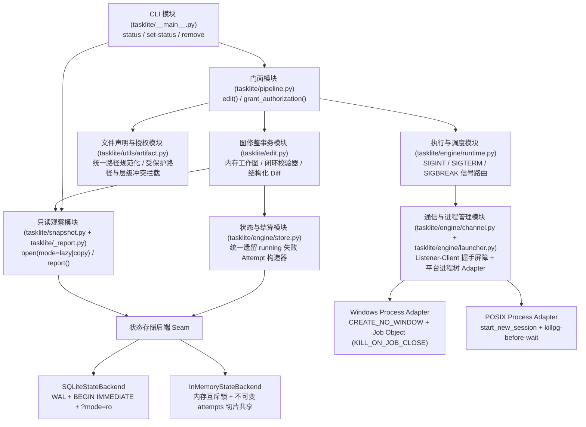

# 0012 原子图修整事务（`edit`）、零句柄快照观测、预授权对称化与跨平台进程树隔离

- **状态**：**已接受并实施**（5 个功能切片——统一跨平台路径策略与 `grant_authorization`、原子图修整 `TaskLite.edit()` 与移除 `set_job_status`/`clear_history`、`StateSnapshot` `copy` 模式与 `report()` 及极简运维 CLI、跨平台信号隔离与进程树原子回收、以及正式文档全量切换——均已落地并通过全量测试验证）
- **适用版本基线**：`3.0.0.dev0`（作为对 [ADR-0011](0011-stable-interface-baseline.md) 的增量修订与冻结前破坏性收敛；不推翻核心三层模型、单写者互斥与数据库格式约束）
- **数据库 Schema 影响**：**零表结构变更**（完全兼容 SQLite Schema 6，`user_version = 6`；`SQLiteStateBackend` 与 `InMemoryStateBackend` 保持 100% 行为对等）

---

## 1. 背景与问题陈述

TaskLite 是基于 **Task（静态规格）/ Job（逻辑实例）/ Attempt（物理轨迹）** 正交三层模型的嵌入式单机 Python 任务编排引擎。在多数据集、多消融维度、单作业耗时数十分钟且外部计算子进程占用 GB 级内存的真实科研长流水线实战中，ADR-0011 基线暴露出五类核心矛盾：

1. **状态演进与 DAG 重构缺乏高层原子抽象**：
   科研探索中高频出现目录/盘符搬迁、新增消融维度导致实验分支改名、4 层拓扑中间插层扩为 5 层、游离缓存纳管、以及上游超时调大 `timeout_seconds` 局部重跑等需求。ADR-0011 的单点管理接口（`set_job_status` / `clear_history`）粒度过碎且语义重叠：既无法在不重入队整棵下游的前提下修改单个节点配置，又迫使迁移脚本陷入“先删旧库（已落盘不可逆）→ 再逐条写入（中途报错则旧成功记录永久丢失且脚本不可重入）”的高危裸奔状态；同时原 `clear_history` 允许删除 `attempts`，直接破坏了物理审计轨迹的 append-only 不变式。
2. **后台非交互环境下的文件清理授权两难**：
   缺少与 `list_authorizations` / `revoke_authorization` 对称的编程式预授权入口，无 TTY 后台流水线被迫在“任务被排除留队”与开启全局高危环境变量 `TASKLITE_DANGEROUS_AUTO_APPROVE=1` 之间二选一。
3. **长耗时运行前后观测与连接生命周期冲突**：
   缺少开箱即用的进度/耗时/ETA 摘要与前后对比视图；且 `StateSnapshot.open()` 在 SQLite 下默认长持只读事务连接，不便于实现“`run()` 前拍快照 → 长跑数小时 → `run()` 后拍快照对比”的零句柄观测模式。
4. **Windows 优雅停机信号穿透与跨平台孙进程残留**：
   Windows 缺乏跨进程 `SIGTERM`，控制台信号易穿透误杀 worker 派生的外部计算孙进程（如 C++/Fortran/R/`ffmpeg`）；作业超时或主进程异常退出时，worker 派生的多层孙进程树易残留为孤儿进程占用内存与文件锁。
5. **编程面与终端运维面职责不清**：
   Python 代码层存在多套状态修改入口导致概念分叉，而终端排障缺少安全、直接的只读与纯 UID 级单行工具。

本 ADR 遵循“小 Interface + 深 Implementation”原则，仅在必要位置增补或收敛公开 Interface，将平台差异与进程树治理彻底下沉为内部 Implementation。

---

## 2. 核心架构裁决总览

1. **锁死 `Attempt` 永不可删，废除零散状态修改 API，收敛为唯一原子图修整上下文 `TaskLite.edit()`**：
   在 `3.0.0` 冻结前，从 `TaskLite` Python 接口中移除 `set_job_status` 与 `clear_history`（不保留旧别名，亦不新增独立的顶层 `clear_job_entries`），彻底移除后端删除 `attempts` 行的一切代码路径。所有 Run 外的 Job 增、删、演进替换与状态扭转统一归口至 `with pipeline.edit(dry_run=True, note=...) as tx:`，通过提交期全图闭环校验与结构化 `diff` 预览消除半成品脏库与静默误删。
2. **严禁“产物不在场的伪成功”，跨机截断确立双管线拆分原则**：
   任何进入 `successes` 且声明了保留型 `role="output"` 的节点，其产出文件必须在磁盘真实存在。对于跨机仅拷贝中间层产物（不拷贝前段巨型原始文件）或手动清理前段中间大文件的场景，规范做法是在切割面拆分为两个独立的 Pipeline（前段 `output` 在后段作为普通 `role="input"`），不在单库内制造无物理产物的伪成功状态。
3. **补齐路径预授权 `TaskLite.grant_authorization`**：
   增量修订 [ADR-0011](0011-stable-interface-baseline.md#主进程所有权授权与通信) 中“不增加手工授权入口”的决定，与 `list_authorizations` / `revoke_authorization` 构成对称 CRUD；坚持“一次性持久化运维动作”定位，重复授权同路径或父子类型冲突显式抛 `TaskLiteError`，不设 `exist_ok` 开关。
4. **增强只读观测面 `StateSnapshot.open(..., mode="lazy"|"copy")` 与 `StateSnapshot.report`**：
   提供一次性加载入内存并立即释放 SQLite 句柄的 `"copy"` 模式；提供单快照状态/ETA 报告与双快照增量对比报告；并在 `tx.before` / `tx.after` 中直接复用 `StateSnapshot` 实现修改前后全量状态检查。
5. **确立“Python 编程面极简唯一、CLI 运维面单行便捷、底层内核与安全契约 100% 对称”**：
   Python 层仅保留 `pipeline.edit()`；CLI（`python -m tasklite`）提供只读 `status` 及纯 `uid` 驱动的 `set-status` / `remove` 单行子命令（`state_path` 均必填无默认值，修改类命令内部 100% 薄封装调用 `pipeline.edit()`，默认 `dry_run` 打印 `diff`，显式传 `--apply` 才落盘；CLI 绝不提供需构造 `Job` 的 `add / replace`）。
6. **下沉跨平台 OS 信号隔离与进程树原子回收（零公开 API 膨胀）**：
   Windows 主进程支持 `SIGBREAK` 优雅排空，worker 采用 `CREATE_NO_WINDOW | CREATE_NEW_PROCESS_GROUP` 分配独立无窗口隐藏控制台隔离信号穿透，并通过 IPC 握手屏障实现零竞态绑定 `JOB_OBJECT_LIMIT_KILL_ON_JOB_CLOSE` Job Object；POSIX 采用 `start_new_session=True` + 先 `killpg` 后 `wait` 原子回收整棵进程组。

---

## 3. 公开 API 详细契约规范

演进后顶层公开导出保持极简（`tasklite.__all__` 不膨胀内部事务实现类，类型注解可通过 `tasklite.edit` 或 `TYPE_CHECKING` 引用）：

```python
from tasklite import (
    TaskLite, Task, Job, JobContext, TaskResult, FileSpec,
    StateSnapshot, TaskLiteError, make_job_uid, parse_job_uid,
)
```

### 3.1 原子图修整上下文：`TaskLite.edit`

```python
with pipeline.edit(
    *,
    dry_run: bool = True,
    note: str | None = None,
) as tx:
    ...
```

#### 3.1.1 生命周期与并发约束

- **调用时机与同实例重入互斥**：仅限 `run()` 外且实例未关闭时调用，否则立即抛 `TaskLiteError`；进入 `with` 块时获取状态库单写者锁（`<state_path>.lock` / 内存写锁）并标记实例进入编辑态（事务期间拒绝同一 `TaskLite` 实例上的 `enqueue`、`set_cursor`、`get_cursor`、`grant_authorization`、`list_authorizations`、`revoke_authorization`、`register_*`、`run`、嵌套 `edit` 与 `close`），退出时释放。严禁在库方法内部隐式读取 `sys.argv`。
- **默认安全（`dry_run=True`）**：默认处于预览演练模式，执行完整闭环校验并生成 `tx.before`、`tx.after` 与 `tx.diff()`，但在退出时**丢弃暂存修改、零磁盘写入**；仅当显式传入 `dry_run=False` 且闭环校验全部通过时，才在单一写事务内原子落盘。
- **顺序工作图模型（KISS 三表原则）**：进入 `with` 时基于当前持久化状态生成只读基准快照 `tx.before: StateSnapshot` 与内存三表工作图（`queue` / `successes` / `failed` + 待补写遗留 `running` 失败 `Attempt`）；块内每次调用原语按字面顺序即时更新对应表分区，仅强制维护 Schema 6 固有的 `successes ∩ failed == ∅` 互斥不变式。
  - *明确边界与 Non-goal*：`remove(entries=...)` 仅按字面清理指定分区，不做跨表隐式联动；`replace` / `replace_many` 不承诺保留原 `queue_position`；异名改名替换（`old_uid != new_uid`）会清空 `old_uid` 在全部三张表中的条目以消除残留幽灵节点并确保孤儿检测生效；显式指定 `status="pending"` 会同步清除目标 `uid` 的历史终态档案以对齐 `set_status(..., "pending")`；仅同名替换且 `status=None` 自动继承 `"pending"` 时保留原终态档案，并通过 `tx.diff()` 的 `[WARNINGS]` 段与 `logger.warning` 提示用户自决。

#### 3.1.2 事务上下文对象 `tx` 的公开属性与方法

1. **存在性查询：`uid in tx`（`__contains__(uid: str) -> bool`）**
   - 校验 `parse_job_uid(uid)` 语法合法（非法抛 `TaskLiteError`），返回该 `uid` 当前是否存在于暂存工作图（`queue ∪ successes ∪ failed`）中。

2. **纯新增节点：`tx.add`**
   ```python
   tx.add(job: Job, *, status: Literal["pending", "succeeded", "failed"]) -> None
   ```
   - 要求 `job.task_type` 已注册且静态配置合法；
   - **防误覆盖**：若 `job.uid` 在当前工作图中已存在，立即抛 `TaskLiteError`；
   - 按指定 `status` 将完整 `job_snapshot` 写入暂存工作图对应分区。

3. **演进替换节点：`tx.replace` 与 `tx.replace_many`**
   ```python
   tx.replace(
       old_uid: str,
       new_job: Job,
       *,
       status: Literal["pending", "succeeded", "failed"] | None = None,
   ) -> None

   tx.replace_many(
       mapping: Mapping[str, Job],
       *,
       status: Literal["pending", "succeeded", "failed"] | None = None,
   ) -> None
   ```
   - **前置约束**：`old_uid`（或 `mapping` 的所有键）在当前工作图中**必须存在**，否则抛 `TaskLiteError`；`new_job.task_type` 必须已注册；替换后不得与工作图中其他存活节点产生 `uid` 冲突（`replace_many` 内部先统一摘除全部旧键再统一放入新 `Job`，天然支持 `step_1 -> step_2, step_2 -> step_3` 编号顺移或互换，映射内若存在重复目标 `new_job.uid` 抛 `TaskLiteError`）。
   - **状态继承规则（当 `status=None` 时）**：
     - 若原条目处于 `succeeded`、`failed` 或 `pending`，新条目**自动继承原状态**；
     - 若原条目为前次崩溃遗留的 `running` 态，自动登记一条待落盘的异常中断 `Attempt`（`outcome="failure"`），并将继承的目标状态收敛为 `"failed"`（若调用方显式指定 `status="pending"` 或 `"succeeded"`，仍登记该失败 `Attempt`，目标状态按显式参数设置）。
   - **审计语义**：不改动 `attempts` 既有历史记录与 `job_sequences` 进度（若换用新 `uid`，旧 `attempts` 原样归属 `old_uid` 不重写）。

4. **纯状态流转：`tx.set_status`**
   ```python
   tx.set_status(
       uid: str,
       status: Literal["pending", "failed"],
       *,
       recursive: bool,
   ) -> None
   ```
   - `recursive` 为必填关键字参数（无默认值）；`uid` 必须存在于当前工作图中，否则抛 `TaskLiteError`；
   - 沿用既有静态 `job_snapshot` 将 `{uid}`（及 `recursive=True` 时工作图正向 `depends_on` 闭包内的全部下游）切换为 `"pending"` 或 `"failed"`；命中的遗留 `running` 条目同样自动登记补写失败 `Attempt`；
   - 刻意不包含 `"succeeded"`——任何未经真实子进程执行而进入 `"succeeded"` 的操作必须通过 `tx.add` 或 `tx.replace` 显式提供 `Job` 定义并接受产出核验。

5. **移除状态条目：`tx.remove`**
   ```python
   tx.remove(
       uid: str,
       *,
       entries: Collection[Literal["queue", "successes", "failures"]] = ("queue", "successes", "failures"),
       recursive: bool,
   ) -> int
   ```
   - `recursive` 为必填关键字参数（无默认值）；`parse_job_uid(uid)` 非法或 `entries` 为空/含非法值（如 `"attempts"`）时抛 `TaskLiteError`；
   - 计算目标集 $T = \{\text{uid}\} \cup (\text{descendants}(\text{uid}) \text{ if recursive else } \emptyset)$；若 `"queue" in entries` 且命中遗留 `running` 条目，自动登记补写失败 `Attempt`；
   - 从指定分区移除目标条目，**绝不重置 `job_sequences`，绝不删除 `attempts`，绝不触发任何磁盘文件删除**；返回本次在工作图中实际移除的 Job 条目数（每个 `uid` 至多计 `1`）。

6. **修改前后全量快照视图：`tx.before` 与 `tx.after`**
   - 类型均为内存只读 `StateSnapshot`（同 `mode="copy"`），退出 `with` 块后仍可安全访问，不持有底层连接；
   - `tx.after` 实时反映当前工作图的投影结果（结构与真实提交后再调用 `StateSnapshot.open()` 100% 同形）。

7. **结构化增量、告警与校验报告：`tx.diff() -> str`**
   - 返回面向人类阅读的紧凑对比文本（不承诺跨版本格式稳定，不作编程解析契约）：
     1. `Before -> After` 四态计数总览；
     2. `[- REMOVED]` 移除列表（**单独置顶高亮标出被移除的 `[succeeded]` 节点**，防止 `recursive=True` 静默误删已算完成果）；
     3. `[⇄ REPLACED]` 替换列表（仅展示发生变化的 `uid`、`status`、`depends_on`、`files` 路径、`payload` 键及配置项，拒绝刷屏未变 JSON）；
     4. `[+ ADDED]` 新增列表与 `[↻ STATUS]` 纯状态流转列表；
     5. `[WARNINGS]` 纯只读非阻断告警（同时同步输出 `logger.warning`），涵盖：① 删除 `[succeeded]` 节点；② 单分区 `remove` 后同 `uid` 仍在另一分区保留；③ `pending` 节点同时存在历史 `successes`/`failed` 档案（下次 `run()` 将由 `Trigger` 依残留档案判定）；④ 非 `succeeded` 上游的 `from_output(p, key)` 未出现在静态 `job_snapshot["files"]` 中（依赖运行期 `ctx.declare_file` 动态声明）；
     6. `[VALIDATION]` 闭环体检结论（`PASS` 或全量错误明细清单）。
   - **永不因校验失败而抛异常中断渲染**：即便工作图存在多处孤儿、环或文件缺失，`tx.diff()` 仍完整返回对比文本与全部错误明细，杜绝“修一个错跑一次脚本”的打地鼠体验。

#### 3.1.3 非执行 `"succeeded"` 写入边界与提交期（`__exit__`）闭环校验

凡通过 `tx.add` 或 `tx.replace` 使节点处于 `"succeeded"` 状态时：
- **零文件删除副作用**：忽略 `FileSpec` 上的 `delete_existing` / `delete_on_success` / `delete_on_failure`，不要求 `authorizations` 清理授权，不检查输入文件磁盘存在性；
- **严格审计隔离与双写发布**：不伪造 `Attempt` 记录；外层 `files` 与 `artifacts` 在写入工作图及验盘时即双写所有保留型 `role="output"`（`delete_on_success=False`）的规范绝对路径（确保 `with` 块内外 `tx.after`、`tx.diff()` 与落盘重开 `StateSnapshot` 100% 同形，且下游 `FileSpec.from_output` 可在后续 `run()` 正常解析）；清除旧执行时间基线并在 `annotations` 写入 `{"completion_source": "manual", "note": note}`（不产生 `trigger="on_input_change"` 的可信执行时间基线）。

当 `with` 块无未捕获异常退出时，引擎对最终工作图 $G_{\text{after}}$ 执行**单次全量攒错校验**（一次性收集全部违规项，不遇错即停）：
1. **存活节点不受损（防删出新孤儿）**：$\forall u \in G_{\text{after}} \cap G_{\text{before}}$，凡在 `tx.before` 中原本存在的上游 $p \in u.\text{depends\_on}$ 且仍留存于 $u_{\text{after}}.\text{depends\_on}$ 中的，在 $G_{\text{after}}$ 中绝不允许消失（除非 $u$ 自身已被更新或一并移除）；
2. **活跃与成功态零孤儿、全图无环**：$G_{\text{after}}$ 中所有处于 `pending` 和 `succeeded` 的节点（以及本次通过 `add / replace` 触碰的全部节点），其 `depends_on` 中的所有上游必须 100% 存在于 $G_{\text{after}}$ 中，且 `depends_on` 有向图严禁存在环路（注：历史上因依赖拼错在 `run()` 后归档于 `failed` 表且本次未触碰的死记录，不连坐阻塞无关分支修整）；
3. **`from_output` 契约闭合（兼容运行期动态 `output`）**：上述节点声明的每个 `FileSpec.from_output(p, key)`，必须满足 `p in u.depends_on` 且 `p` 存在于 $G_{\text{after}}$；当 `p` 处于 `succeeded` 时，`key` 必须存在于 `p` 已发布的外层 `files` / `artifacts` 中且为保留型 `role="output"`（天然兼容运行期经 `ctx.declare_file` 动态声明的产出）；当 `p` 非 `succeeded` 时，若 `p` 的静态 `job_snapshot["files"]` 已声明 `key`，强制校验其为保留型 `role="output"`（未静态声明则以 Warning 提示其依赖运行期动态声明）；
4. **物理产出真实在场**：本次通过 `add / replace` 处于 `"succeeded"` 的所有节点，其声明的保留型 `role="output"` 路径必须全部通过统一 `PathPolicy.inspect(..., mode="strict")`（受保护 5 路径、根路径与符号链接/Junction 检查），并在磁盘上真实存在。

**退出结算规则**：
- 若校验存在任何错误：无论 `dry_run` 取何值，一律回滚/丢弃暂存状态，并将**全部错误汇总抛出单一 `TaskLiteError`**（底层非预期 OS 异常如 `PermissionError` 或 `sqlite3` IO 故障原样向上传播）；
- 若校验全部通过且 `dry_run=True`：丢弃暂存修改，零副作用正常退出；
- 若校验全部通过且 `dry_run=False`：经极薄 4 字段无序声明式后端提交 Seam（`GraphEditCommit`：`queue_writes` / `success_writes` / `failed_writes` / `recovery_attempts`），在**单个 SQLite `BEGIN IMMEDIATE` 写事务**（或内存锁 Copy-on-Write 临界区）内原子落盘。

---

### 3.2 Run 外显式路径预授权：`TaskLite.grant_authorization`

```python
pipeline.grant_authorization(
    path: str | Path,
    *,
    target_type: Literal["file", "directory"],
) -> dict[str, Any]
```

- **调用时机**：仅限 `run()` 外且实例未关闭时调用，否则抛 `TaskLiteError`；
- **路径与类型解析（统一路径策略 `PathPolicy`）**：
  - 相对路径基于 `TaskLite` 构造期固定的 `base_dir`，通过与 `revoke_authorization`、运行期 `FileSpec` 及 `edit()` 非执行 `succeeded` 验盘**完全同一套规范化 Module**（仅展开最长已存在父前缀、绝不跟随叶节点链接、统一平台盘符/长名）解析为规范绝对路径；
  - 必须通过关键字参数显式指定 `target_type`（`"file"` 或 `"directory"`），**不要求目标路径在磁盘上已存在**，也不创建任何文件或目录；
  - 复用统一受保护路径硬拦截规则：由 `PathPolicy` 基于 `state_path` 单点派生并保护全部 5 项内部路径（`state_path`、`-wal`、`-shm`、`-journal` 与 `<state_path>.lock`），连同文件系统根 / 盘符根 / UNC 根一并按路径段元组双向重叠拦截（禁止 `str.startswith`），命中一律抛 `TaskLiteError` 拒绝（不向 `AbstractStateBackend` 增加额外方法）；
  - **跨平台安全清理与物理限制声明**：`PathPolicy` 内部通过 `FilesystemAdapter` Seam 分派至 POSIX（`dir_fd` / `O_NOFOLLOW` / `O_DIRECTORY` / Linux `/proc/self/mountinfo`）与 Windows（仅 3 个无特权 `kernel32` 函数：`CreateFileW` 省略 `FILE_SHARE_DELETE` 内核级钉锁父目录 + `GetFileInformationByHandle` 身份复核 + `CloseHandle`，结合 `os.lstat` 原生 `st_file_attributes` / `st_reparse_tag` 区分 symlink、Junction/卷挂载点 fail-closed 及非名称代理云占位文件）；Windows 下不隐式去除只读位、不掩盖文件占用（`WinError 32` / `WinError 5` 原样传播），并保留与 POSIX `fstatat -> unlinkat` 同构的同目录普通叶替换微窗口（因 `unlink`/`rmdir` 不跟随链接且 `rmdir` 拒删非空目录，绝不穿透目录外）；
  - 同期修复 `lockfile.py`：Windows 加锁前显式 `os.lseek(fd, 0, SEEK_SET)`，仅将锁争用 `errno` 映射为 `None`，真实 IO 故障原样上抛；
- **一次性运维定位与冲突硬拦截（无 `exist_ok`）**：
  - 授权持久化于状态库并跨 Run 复用，属于一次性运维管理动作，不鼓励写入每次启动脚本反复调用；
  - Schema 6 `authorizations(path TEXT PRIMARY KEY)` 零改表下，SQLite 与内存双后端在事务/锁内统一按平台比较键（Windows 经 `os.path.normcase`）与 `PurePath.parts` 元组判定冲突与匹配；
  - 若库中已存在**相同规范绝对路径**（或 Windows 大小写等价路径）记录（无论 `target_type` 是否一致），不静默幂等、不刷新时间戳，直接抛 `TaskLiteError`；
  - 若存在逻辑矛盾的父子类型关系（如祖先已按 `"file"` 授权又授权子路径，或已存在子路径授权又将祖先按 `"file"` 授权），一律抛 `TaskLiteError`；
  - 父子目录授权与 `revoke_authorization(path)` 对称，各自按精确规范绝对路径独立存取与撤销，互不隐式合并或覆盖；运行期交互式授权升级（`record_authorization` 的 `file -> directory` 覆盖）与运维期 `grant_authorization` 严格分离，互不破坏；
- **返回值**：返回与 `list_authorizations()` 单项同构的字典 `{"path": str, "target_type": str, "authorized_at": str}`。

---

### 3.3 只读快照拷贝模式与对比报告：`StateSnapshot`

```python
StateSnapshot.open(
    source: str | Path | TaskLite,
    *,
    mode: Literal["lazy", "copy"] = "lazy",
) -> StateSnapshot

StateSnapshot.report(
    first: StateSnapshot,
    second: StateSnapshot | None = None,
) -> str
```

- **`StateSnapshot.open`**：
  - SQLite 路径源继续强制只读 URI（`?mode=ro`），路径不存在或 Schema 不匹配直接抛 `TaskLiteError`，绝不新建空库文件；非法 `mode` 抛 `TaskLiteError`；
  - `mode="lazy"`（默认）：维持 ADR-0011 行为（SQLite 持有只读事务流式按需读取，关闭时释放连接；内存后端捕获一致快照）；
  - `mode="copy"`：SQLite 源在单一只读事务内读取一致快照后**立即关闭底层连接**，调用方无需在长耗时 `run()` 期间维持打开的文件句柄（内部对大字段 JSON 采用按需惰性反序列化；`InMemoryStateBackend` 源对只追加不可变的 `attempts` 列表采用切片浅共享以控制内存峰值）；仍兼容 `with` 与 `close()`，显式 `close()` 后继续访问仍按既有契约抛 `TaskLiteError`。
- **`StateSnapshot.report`**：
  - 单快照（`second=None`）：输出四态计数（含 `succeeded` 的 `execution / manual` 构成）、各 `task_type` 完成进度与历史成功 Attempt 耗时统计（Avg / P50 / Max）、在途 `running` 已运行秒数与基于历史基线的预估剩余时间（ETA）、当前 `failed` 摘要；
  - 双快照对比（`before, after`）：与单快照保持结构一致与高度复用——以 `second`（`after`）为主干结构，叠加 `first -> second` 区间计数增减、状态流转汇总、新增 Attempt 次数/耗时及本次新增失败明细；
  - **非编程解析契约**：传入非 `StateSnapshot` 实例或已关闭快照抛 `TaskLiteError`；返回的多行 `str` 仅供人类阅读展示，不承诺文本排版或字段格式跨版本稳定；编程消费状态数据继续使用 `get_job` / `iter_jobs` / `iter_attempts`。

---

### 3.4 命令行运维入口：`tasklite` / `python -m tasklite`

CLI 通过 `pyproject.toml` `[project.scripts]` 暴露 `tasklite = "tasklite.__main__:main"`，与 `python -m tasklite` 双入口完全等价；严格定位于**只读观测与纯 `uid` 驱动的轻量状态运维**（`state_path` 均必填无默认值；不提供 `--json` 选项，不新增任何引擎调度语义；修改类命令底层 100% 薄封装委托给 `TaskLite.edit()`，默认预览不落盘）：

```bash
# 1. 只读状态报告（薄封装 StateSnapshot.open + StateSnapshot.report；亦可用 python -m tasklite）
tasklite status <state_path>

# 2. 纯状态流转（默认 dry_run 打印 diff，传 --apply 才落盘；--recursive / --no-recursive 必选其一）
tasklite set-status <state_path> <uid> <pending|failed> (--recursive | --no-recursive) [--note TEXT] [--apply]

# 3. 移除状态条目（默认清理三表、默认 dry_run 打印 diff，传 --apply 才落盘）
tasklite remove <state_path> <uid> [--entries queue,successes,failures] (--recursive | --no-recursive) [--note TEXT] [--apply]
```

---

### 3.5 跨平台信号优雅停机与子进程树原子回收（内部契约，零新增公开 API）

本节在正确性 > 可预测性 > 出错时维护复杂度 > 调度性能的裁决序下，将进程拉起、IPC 握手与 OS 进程树隔离收敛为 `ExecutionChannel` 下方的双层 Internal Seam（`WorkerLauncher` + `ManagedWorkerHandle`，以及 `ProcessTreeAdapter`），提取纯 worker 侧执行与统一停止信号模块 `_worker_runtime.py`，并彻底清除 `TaskLite` / `ExecutionChannel` 上过时的 `_process_context` 私有属性（`tasklite.testing.in_process_workers(target, launcher=None)` 直接接受标准 `WorkerLauncher` seam）：

1. **主进程优雅停机信号与可中断等待**：
   - `run(install_signals=True)` 经 `install_stop_signals` 在 POSIX 监听 `SIGTERM` / `SIGINT`，在 Windows 监听 `SIGTERM` / `SIGINT` / `SIGBREAK`（对应 `CTRL_BREAK_EVENT`），按 LIFO 逆序恢复原处理器；统一路由至线程安全的 `self.stop()`（停止派发新作业，等待在途 worker 自然结算后退出）。
   - **Windows 信号可达性修复**：`RunNotifier.wait()` 在 Windows 下将长超时/无限等待切片为 `<= 0.1s` 循环，防止主线程阻塞于 `Event.wait(3600)` 导致 `SIGBREAK`/`SIGINT` 被推迟数十分钟才投递。
   - *OS 物理边界声明*：Windows 下无关联控制台的纯后台服务（如 `pythonw.exe` 或 Windows Service）在 OS 层面无法接收 `CTRL_BREAK_EVENT`，此类宿主须在进程内跨线程调用 `pipeline.stop()`。
2. **单 `Listener` 双物理连接握手屏障与零停机卡顿提交门**：
   - 统一采用 `subprocess.Popen` 配合标准库 `multiprocessing.connection.Listener / Client`（Windows `AF_PIPE`、POSIX `AF_UNIX` 含长路径回退 `/tmp`，随机 32 字节 `authkey` 经私有环境变量传递并由子进程启动即 `pop`，严禁写入命令行参数）。
   - **双物理单向连接零竞态**：worker 依次向同一 `Listener` 建立 `role="uplink"`（`declare`/`result`）与 `role="downlink"`（`reply`）两条独立物理连接，收齐后立即关闭 `Listener`；完整复用 `tasklite/utils/ipc.py` 既有单向收发原语与非对称关闭契约（`result` 到达即物理关闭 `reply_sender`，`receiver` 与进程句柄同寿），彻底根除 Windows `PipeConnection._close()` 并发句柄竞态。
   - **可中断 `accept()` 与异常清扫**：通过 `HandshakeAcceptor` 守护线程配合主线程 50ms 切片检查 `cancel_event` / `proc.poll()` / `deadline`（中断时自连发送 `role="cancel"` 立即解除阻塞，零耦合私有 `_winapi` 重叠 IO）；`ExecutionChannel` 通过单一 `_ExecutionSession` 状态机（`prepared -> active -> lingering -> closed`）统一管理所有准备中、在途与滞留会话，确保 `request_stop()` 与崩溃网 `abort_in_flight()` 均可即时唤醒并清扫半初始化空壳进程树。
   - **线性两阶段锁外冷启动 + 微秒级 `b"GO"` 门**：经 `prepare_spawn` → `release_spawn` / `abort_spawn` 线性控制流，`Popen`、双连接握手、OS 进程树绑定以及预送 `prep_bytes`（纯 JSON 还原 `sys.path`/`cwd`/`__mp_main__`，内置 Fork-Bomb 重入守卫并跳过 `pytest`/`*.__main__`）与 `payload_bytes`（pickle 载荷）全部在 `_dispatch_start_lock` **之外**完成；worker 仅缓存 bytes 不执行任何用户代码；父进程在微秒级短持 `_dispatch_start_lock` 内二次校验 `_dispatch_allowed()`，通过则发 2 字节 `b"GO"` 放行并原子登记 `in_flight`，拒绝则立即经 `abort_spawn` 强杀空壳并回退 `pending`（零副作用、不写 `Attempt`）。引导期导入或 unpickle 失败（如 handler 误写于 `if __name__ == "__main__":` 内）经已就绪 `uplink` 回传结构化 `failure` 帧并附明确提示。
   - **Windows 控制台隔离**：传入 `creationflags = subprocess.CREATE_NO_WINDOW | subprocess.CREATE_NEW_PROCESS_GROUP`（`stdin=subprocess.DEVNULL`，继承 `stdout` / `stderr`），为 worker 分配独立无窗口隐藏控制台——彻底阻断主进程控制台 `Ctrl+C` / `Ctrl+Break` 向 worker 及其外部孙进程穿透，同时避免桌面环境弹出闪烁黑框。
3. **进程树零竞态绑定、句柄保活与退出码归一化**：
   - **Windows Job Object**：`WindowsProcessTreeAdapter` 在 worker 阻塞于握手屏障、尚未执行任何用户代码前创建匿名 Job Object（`ctypes` 显式声明 64 位安全的 `argtypes`/`restype`/`c_size_t`），**仅设置 `JOB_OBJECT_LIMIT_KILL_ON_JOB_CLOSE`**（严禁 `JOB_OBJECT_LIMIT_BREAKAWAY_OK`）；`AssignProcessToJobObject` 失败必须立即强杀空壳并 fail-loud，严禁降级裸跑。**句柄保活红线**：`hJob` 封装于 `WindowsManagedWorkerHandle` 内，会话处于 `lingering` 期间绝不提前 `CloseHandle(hJob)`，仅在进程自然退出并 `join` 后或超时/中止经 `TerminateJobObject` + `join` 后才释放。
   - **POSIX 进程组**：`PosixProcessTreeAdapter` 以 `start_new_session=True` 原子建新进程组；超时或强杀时**严格先调用 `os.killpg(proc.pid, signal.SIGKILL)`，再调用 `proc.wait()`**，杜绝先回收组长 PID 导致的极端 PID 复用误杀。
   - **跨平台退出码归一化**：`ManagedWorkerHandle.exitcode` 忠实反映 OS 退出码（不在 Windows 伪造 `-9`），并通过 `was_force_killed` 在失败结果 `annotations` 中规范区分信号终止与框架强杀。

---

## 4. 模块化架构落点

严格遵守单向依赖红线：`cli` → `pipeline`（门面装配）/ `snapshot` → `engine` / `backend` / `models` → `utils`；`models` 严禁反向依赖 `engine`。



---

## 5. 明确否决的替代方案与保持不变的边界

### 5.1 明确否决的替代方案

| 被否决方案 | 否决理由 |
| :--- | :--- |
| **保留顶层 `set_job_status` / `clear_job_entries` 并新增独立 `adopt_job`** | 多入口职责交叉；“先 `clear` 落盘再循环 `adopt`”在遇到缺文件报错时会导致旧成功记录不可逆丢失且迁移脚本无法重入。 |
| **局部字段改名 `rename_job(old_uid, new_uid, files=...)`** | 制造“新 UID + 新路径 + 旧 `payload`”的缝合快照（日后重排 `pending` 必炸），迫使引擎跨全表拆改 JSON，且无法处理插层与新增纳管。 |
| **在 `job_id` 中编码父 `job_id` 形成级联命名** | 混淆 DAG 与树：多父汇聚节点导致 ID 指数级膨胀，中间插层引发全图下游 UID 雪崩，且与 `depends_on` 形成双源冲突。 |
| **新建 `job_aliases` 曾用名表追踪改名历史** | 旧实验名被新基准实验复用时会引发 `attempts` 归属碰撞与 `job_sequences` 序号分叉，查询传递闭包复杂度极高而实际收益极低。 |
| **在 `FileSpec` 中引入 `{job_id}` 路径占位符** | `job_id` 允许含 `:`、`*`、`/`、`..` 等字符，直接展开进路径会导致 Windows 非法路径崩溃或目录越界，且束缚多维嵌套目录表达。 |
| **修改 `FileSpec` 时由引擎自动搬移磁盘文件** | 跨盘符 `copy + unlink` 无文件系统事务回滚，中途 `ENOSPC` / 中断会损毁算了十几个小时的 GB 级科研产物，且混淆 `mv`/`cp`/`rsync` 语义并刺穿清理授权红线。 |
| **已提交事务的事后库内 `undo()` 时光机** | 与后续 `run()` 追加的不可变 `attempts` 及单调递增 `job_sequences` 正面冲突；`edit(dry_run=True)` 默认预演已前置消除结构误操作。 |
| **TOML 迁移规则单 / 导出全量 JSON 人工改文本导回** | 违背“Python 代码即唯一规格源（DRY）”，手改上万行含 `%XX` 编码的快照极易出错且难以表达动态循环生成的拓扑演进。 |
| **`grant_authorization(..., exist_ok=True)` 与 `warnings` 回执字典** | 纵容把一次性运维授权塞进日常启动循环；违背“该失败就失败、绝不返回无人检查的 warnings 字典”与“不持久化物理 stat 指纹”的极简信条。 |
| **基于状态库的带外停机协议（`request_stop(state_path)` 写 `engine_metadata` 停止标志）** | 状态库仅应持久化业务与作业状态事实，不应充当跨进程控制信道；将停机控制塞入数据库违背操作系统直觉并引入额外存储耦合，改由 OS 原生信号适配解决。 |
| **在 `TaskLite` 核心新增启动前 `dry_run()` 预检** | 维持 ADR-0011 移除 `payload_schema` 的裁决；业务 handler 的静态符号检查与载荷透传验证交由静态类型检查器及 `tasklite.testing.fake_ctx` 承担，且避免与 `edit(dry_run=True)` 概念混淆。 |

### 5.2 明确保持不变的既有边界

- **保持 `state_path` 必填无默认值**：`TaskLite(backend="sqlite", state_path=...)` 及所有 CLI 子命令继续强制要求显式传入 `state_path`，不引入隐式默认数据库文件名。
- **`enqueue` 维持现状**：不新增 `overwrite` 参数，不增加跨终态档案的配置冲突拦截；需要区分的业务维度（如不同数据集或实验参数）应显式体现在 `job_id` 命名中。
- **不提供自动原地路径迁移或库内改名工具**：所有目录搬迁与拓扑演进统一由用户通过 OS 工具搬运文件后，在 `pipeline.edit()` 中显式声明目标 `Job` 并经闭环验盘提交。

---

## 6. 典型科研演进场景验证矩阵与标准范式

| 场景 | 标准操作路径（基于 ADR-0012） | 安全保障机制 |
| :--- | :--- | :--- |
| **1. 换盘符 / 多盘符搬迁** | OS 执行 `mv` → 新脚本遍历 `build_jobs()`，对 `if j.uid in tx:` 调 `tx.replace(j.uid, j)` | 自动继承原 `succeeded / failed / pending` 状态；1 个文件漏移则整单回滚。 |
| **2. 历史游离缓存纳管** | 移入规范路径 → `tx.add(cache_job, status="succeeded")` | 强制验盘并发布具名 `output`，防覆盖既有同 UID 任务。 |
| **3. 新增维度致老枝条改名** | OS 改目录名 → 按新旧映射调 `tx.replace(old_uid, new_job)`（或编号顺移用 `tx.replace_many`） | 无需调 `remove(recursive=True)`；漏迁任何下游或旁路汇总节点均由孤儿检查当场拦截。 |
| **4. 局部改大 `timeout` 重跑** | `tx.set_status(up_uid, "pending", recursive=True)` + `tx.replace(up_uid, new_up_job)` | 20 个下游无需删掉重入队，仅原地更新上游超时配置并一键重排。 |
| **5. 4 层拓扑中间插层为 5 层** | `tx.add(mid_layer_job, status="succeeded")` + `tx.replace(l2_uid, updated_l2_job)` | 无产物占位层与有产物计算层原语完全统一；`from_output` 键闭合提交期一次验清。 |
| **6. 跨机截断 / 中途拆分双管线** | 切割面 `L3` 改用 `role="input"` 指向前段产出文件；若 `L3` 已跑完，复制库文件后 `tx.remove(前段)` + `tx.replace(L3.uid, root_L3)` | 彻底杜绝单库内“无物理产物的伪成功”，后续全量 `enqueue` 绝不误触发前段 500GB 任务重算。 |

### 标准单文件迁移脚本范式

```python
import argparse
import json
from pathlib import Path
from tasklite import TaskLite, TaskLiteError

def main() -> int:
    parser = argparse.ArgumentParser()
    parser.add_argument("--state-path", type=Path, required=True)
    parser.add_argument("--apply", action="store_true", help="提交落盘（默认 dry_run=True）")
    parser.add_argument("--full", action="store_true", help="打印修改前后全量快照")
    args = parser.parse_args()

    pipeline = TaskLite(backend="sqlite", state_path=args.state_path)
    register_all_tasks(pipeline)

    try:
        with pipeline.edit(dry_run=not args.apply, note="schema v1 -> v2") as tx:
            for old_uid, new_job in build_migration_map().items():
                if old_uid in tx:
                    tx.replace(old_uid, new_job)

            print(tx.diff())
            if args.full:
                print(json.dumps(list(tx.after.iter_jobs()), indent=2, ensure_ascii=False))
        return 0
    except TaskLiteError as exc:
        print(f"Edit rejected & rolled back:\n{exc}")
        return 1
    finally:
        pipeline.close()
```

---

## 7. 实施、测试验收与文档同步清单

本节汇总实施本 ADR 时须同步完成的代码、测试与文档调整项（实施前须结合源码逐项核验技术可行性后按独立切片推进）：

### 7.1 代码实现调整

1. **原子图修整事务与旧接口移除（`TaskLite`、`EditTransaction`、`StateStore` 与双后端）**：
   - 新增 `TaskLite.edit(*, dry_run: bool = True, note: str | None = None)` 与内存工作图事务对象（`__contains__` / `add` / `replace` / `replace_many` / `set_status` / `remove` / `before` / `after` / `diff`）；
   - 实现 `__exit__` 单次全量攒错闭环校验（防删出新孤儿、活跃/成功态零孤儿与无环、`from_output` 契约闭合、非执行 `"succeeded"` 物理产出在场与受保护路径/符号链接检查）及单写事务原子提交；
   - 统一遗留 `running` 失败 `Attempt` 构造逻辑，确保触碰或移除遗留 `running` 时自动补写失败 `Attempt`；
   - 从 `TaskLite` 移除 `set_job_status` 与 `clear_history`（不保留旧名别名），并彻底移除 `StateStore` 及双后端删除 `attempts` 行的一切路径。
2. **Run 外预授权（`TaskLite`、路径规范化与双后端）**：
   - 在 `TaskLite` 上新增 `grant_authorization(path: str | Path, *, target_type: Literal["file", "directory"]) -> dict[str, Any]`；
   - 统一 `grant_authorization`、`revoke_authorization` 与运行期 `FileSpec` 路径规范化函数（含已存在父前缀符号链接解析与平台盘符规范化）及受保护路径硬拦截；
   - 在 SQLite 与内存双后端实现精确同路径冲突与父子类型矛盾硬拦截（抛 `TaskLiteError`，不刷新时间戳）。
3. **只读快照拷贝模式与可读报告（`StateSnapshot`）**：
   - 扩展 `StateSnapshot.open(source, *, mode: Literal["lazy", "copy"] = "lazy")`：SQLite 源保持 `?mode=ro`，`mode="copy"` 于单一只读事务内加载后立即关闭连接并惰性反序列化大字段 JSON；内存源对不可变 `attempts` 切片浅共享；
   - 新增 `StateSnapshot.report(first: StateSnapshot, second: StateSnapshot | None = None) -> str`：单快照涵盖四态计数（含 `execution / manual`）、各 `task_type` 进度与 `Avg / P50 / Max` 耗时统计、在途 ETA 及失败摘要；双快照复用主干并叠加区间增量；校验入参类型与未关闭状态。
4. **命令行运维入口（`tasklite/__main__.py`）**：
   - 实现 `status`、`set-status` 与 `remove` 三个子命令；`state_path` 均必填无默认值，修改类命令底层 100% 委托 `TaskLite.edit()`，默认 `dry_run=True` 打印 `diff`，显式 `--apply` 才落盘。
5. **跨平台 OS 信号隔离与进程树原子回收（执行与通信内部实现）**：
   - Windows 下 `run(install_signals=True)` 补充注册 `signal.SIGBREAK` 监听路由至 `self.stop()`；
   - 改造 worker 启动与通信通道为 `subprocess.Popen` + `multiprocessing.connection.Listener / Client` 握手屏障：Windows 下启用 `CREATE_NO_WINDOW | CREATE_NEW_PROCESS_GROUP` 并零竞态绑定仅含 `JOB_OBJECT_LIMIT_KILL_ON_JOB_CLOSE` 的匿名 Job Object；POSIX 下启用 `start_new_session=True` 与严格 `os.killpg` 先于 `proc.wait()` 回收。

### 7.2 测试验收调整

- **原子图修整测试**：覆盖 `edit(dry_run=True/False)` 锁互斥与 Run 期拒绝、`add / replace / replace_many / set_status / remove` 全原语、`tx.before / tx.after / tx.diff()`、4 项闭环校验的单次全量攒错与整单回滚、遗留 `running` 自动补写失败 `Attempt`、`attempts` 不可删与 `job_sequences` 永不重置、双后端对等，以及迁移或替换原 `set_job_status` / `clear_history` 全部旧测试；
- **预授权测试**：覆盖 Run 外正常授权、Run 期/关闭后拒绝、受保护路径硬拦截、精确同路径重复授权与父子类型矛盾（file/directory 交叉）抛 `TaskLiteError`、父子目录独立存取撤销，以及双后端对等；
- **快照与 CLI 测试**：覆盖 `mode="copy"` 立即释放 SQLite 连接并在 `run()` 前后无连接泄漏地对比、`StateSnapshot.report` 单/双快照复用输出与关闭快照报错，以及 `python -m tasklite status / set-status / remove`（含默认预览与 `--apply` 落盘）端到端测试；
- **跨平台进程测试**：覆盖超时/异常中止时真实 worker 及其多层派生孙进程树的内核级原子清理、Windows 下 `SIGBREAK` 优雅排空且不向在途子进程穿透控制台信号，以及 POSIX 进程组先 `killpg` 后 `wait` 回收验证。

### 7.3 文档同步切换（实现验收完成后同步）

- **[CONTEXT.md](../../CONTEXT.md)**：将 `Failed（失败档案）` 正名为 `Failures（失败档案）`，明确区分 Job 四态（`pending / running / succeeded / failed`）、Attempt 三种结果（`success / failure / retry`）、Job 三类存储条目（`queue / successes / failures`）与严格 append-only 不可删除的 `attempts`；将 `set_job_status` / `clear_history` 更新为 `TaskLite.edit()`；补充 `grant_authorization` 与 `StateSnapshot.report`；
- **[docs/API.md](../API.md)**：用 `TaskLite.edit()` 章节替换 `set_job_status` / `clear_history`；补充 `grant_authorization`、`StateSnapshot.open(..., mode=...)`、`StateSnapshot.report` 及 `python -m tasklite` CLI 完整契约；
- **[docs/GUIDE.md](../GUIDE.md)**：更新 Run 外运维章节（`edit()` 原子图修整与双管线拆分原则、预授权）、运行前后 `mode="copy"` 快照对比与 CLI 示例，以及跨平台信号与子进程树回收行为说明；
- **[docs/ROADMAP.md](../ROADMAP.md)**：更新 CLI 与后续候选条目状态，关联本 ADR；
- **[README.md](../../README.md)**：按需同步目录结构与运维入口导航；
- **[ADR-0011](0011-stable-interface-baseline.md)**：仅在对应说明处补充“部分条款由 ADR-0012 增量修订”的交叉引用，不改写历史正文。
